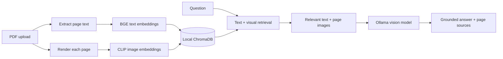

<div align="center">

# Atlas — Multimodal document chat

**Ask questions about both the text and the visuals in your PDFs.**

[](https://www.python.org/)
[](https://streamlit.io/)
[](https://ollama.com/)
[](./LICENSE)

[Quick start](#-quick-start) · [Features](#-what-it-does) · [How it works](#-how-it-works) · [Running guide](./RUNNING_GUIDE.md) · [Troubleshooting](#-troubleshooting)

</div>

---

## ✨ What it does

Atlas is a local-first PDF assistant inspired by the [multimodal RAG pipeline walkthrough](https://amanxai.com/2026/07/22/build-a-multi-modal-rag-pipeline/). Upload one or more PDFs, then ask questions in a chat interface. Retrieval considers extracted page text **and** a visual snapshot of each page, so charts, diagrams, and tables can help ground an answer.

- **PDF understanding:** extracts searchable text and renders every page, including pages whose diagrams are vector artwork rather than embedded images.
- **Hybrid retrieval:** uses BGE text embeddings and CLIP image/text embeddings, stored locally in ChromaDB.
- **Vision answers:** sends the best matching pages and their text context to a vision-language model served by Ollama.
- **Citations:** answers can cite retrieved sources by filename and page.
- **Private by default:** files, embeddings, and rendered pages are stored on your machine; model calls go only to the Ollama URL you configure.
- **Practical controls:** index multiple PDFs, inspect retrieved page evidence, and clear the chat without deleting your index.

> **You need Ollama running** with a vision model for answer generation. Embedding models are downloaded from Hugging Face on first use; expect a longer first launch.

## 🚀 Quick start

### 1. Prerequisites

- Python **3.11 or newer** (64-bit; Python 3.14 may not have compatible PyTorch wheels yet).
- [Ollama](https://ollama.com/download) installed and running.
- Several gigabytes of free disk space for Python packages and model weights.

### 2. Install

<details>
<summary><strong>Windows PowerShell</strong></summary>

```powershell
py -3.12 -m venv .venv
.\.venv\Scripts\Activate.ps1
python -m pip install --upgrade pip
pip install -r requirements.txt
```

</details>

<details>
<summary><strong>macOS / Linux</strong></summary>

```bash
python3.12 -m venv .venv
source .venv/bin/activate
python -m pip install --upgrade pip
pip install -r requirements.txt
```

</details>

### 3. Prepare Ollama

```bash
ollama pull qwen2.5vl:3b
```

Keep Ollama running. The app defaults to `http://localhost:11434` and `qwen2.5vl:3b`; both can be changed in the sidebar.

### 4. Launch Atlas

```bash
streamlit run app.py
```

Open the local URL printed by Streamlit (normally <http://localhost:8501>), upload a PDF in the sidebar, select **Index selected PDFs**, and ask a question.

> Want every setup detail? Open the clickable [Running guide](./RUNNING_GUIDE.md).

## 🧭 How it works



### Project map

| Path | Purpose |
|---|---|
| `app.py` | Streamlit upload, indexing, chat, and source display |
| `multimodal_rag/engine.py` | PDF processing, embeddings, retrieval, and Ollama requests |
| `tests/test_engine.py` | Fast unit tests for text splitting and retrieval helpers |
| `.data/` | Local ChromaDB and rendered page images (created at runtime; git-ignored) |
| `requirements.txt` | Python dependencies |
| [`RUNNING_GUIDE.md`](./RUNNING_GUIDE.md) | Detailed install, launch, hardware, and troubleshooting steps |

## 🛠️ Configuration

| Setting | Default | Where to change it |
|---|---|---|
| Ollama server | `http://localhost:11434` | Sidebar → Ollama URL |
| Vision model | `qwen2.5vl:3b` | Sidebar → Model name |
| Text embedding model | `BAAI/bge-small-en-v1.5` | `multimodal_rag/engine.py` |
| Image embedding model | `openai/clip-vit-base-patch32` | `multimodal_rag/engine.py` |
| Per-PDF upload limit | 50 MB | `MAX_PDF_SIZE` in `app.py` |
| Local index and page images | `.data/` | `DATA_DIRECTORY` in `app.py` |

The text and CLIP models are downloaded from Hugging Face and run on the detected GPU when available, otherwise on CPU. Ollama inference runs on the Ollama host. Do not expose an unauthenticated Ollama endpoint to an untrusted network.

## ✅ Run tests

With the project environment activated:

```bash
python -m unittest discover -s tests -v
```

## 🧰 Troubleshooting

<details>
<summary><strong>Ollama connection refused</strong></summary>

Start the Ollama application or service, confirm it responds at the sidebar URL, and check that the selected model is installed with `ollama list`.

</details>

<details>
<summary><strong>Model not found</strong></summary>

Run `ollama pull qwen2.5vl:3b`, or enter the exact name of another Ollama vision model in the sidebar.

</details>

<details>
<summary><strong>First indexing is slow or downloads are large</strong></summary>

The BGE and CLIP weights download the first time indexing or chat needs them. Later runs reuse the local Hugging Face cache. CPU-only inference works but may be slow; close other memory-heavy applications if a model fails to load.

</details>

<details>
<summary><strong>PDF has no selectable text</strong></summary>

Rendered page images are still indexed. For OCR-based text search on scanned documents, add an OCR step before `chunk_text` in `multimodal_rag/engine.py`.

</details>

## 📄 License

This project is provided under the MIT License. See [`LICENSE`](./LICENSE).
